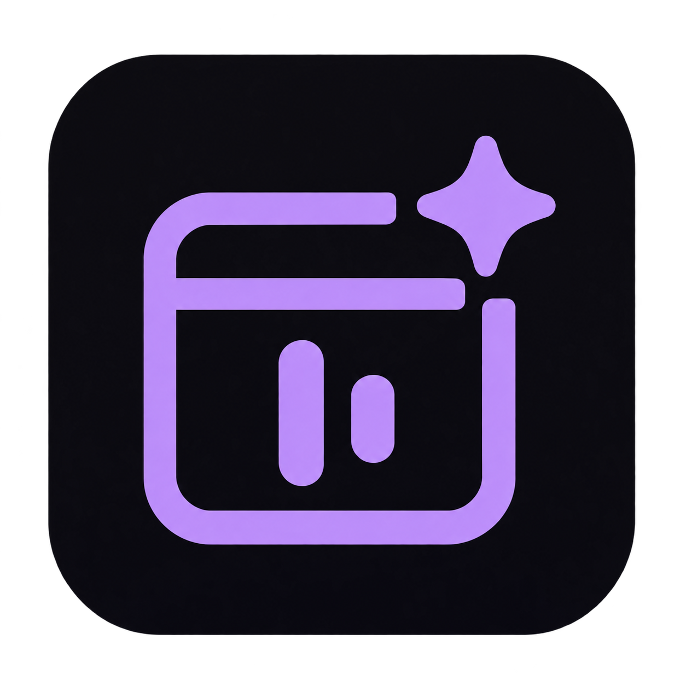

# CuePane

CuePane is a compact Windows overlay for notes, questions, and screenshots. It can transcribe system audio and send questions or screenshots to the OpenAI API using your own key.

## Getting started

1. Download and run CuePane-Setup.exe from Releases, then open CuePane from the Start menu.
2. Open Settings and enter an OpenAI API key. Add notes or code and save a named profile if you want to reuse them.
3. Use Ctrl+Shift+F9 to start or stop listening. Use Ctrl+Shift+F10 to stage a screenshot of the display under your pointer.
4. Type a question or optional screenshot message and select Send. You can send text, an image, or both.

The overlay supports moving by its title and resizing at its edges. Screen-capture exclusion depends on Windows and the capturing application.

## Data

Profiles are protected with Windows DPAPI for the current Windows user. They are stored in %LOCALAPPDATA%\MeetAssistant\Profiles for compatibility with earlier builds. Audio segments are sent to OpenAI while listening. Screenshots are held in memory and are sent only when you select Send. API usage is billed to your OpenAI account.

## Build

On 64-bit Windows, run the following in PowerShell:

```powershell
powershell.exe -NoProfile -ExecutionPolicy Bypass -File .\build.ps1
```

The build uses the system .NET Framework C# compiler and writes the portable executable and installer to dist. The installer is per-user and unsigned. It adds a Start menu shortcut and can be removed through Windows Installed apps. Uninstalling preserves saved profiles.
